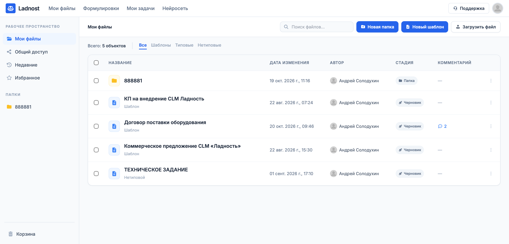
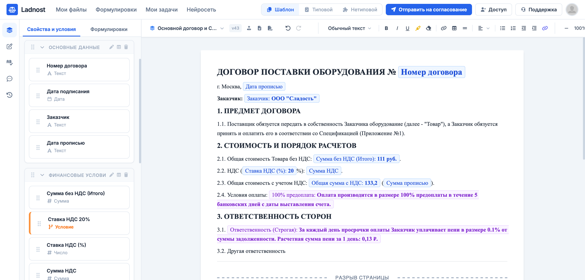
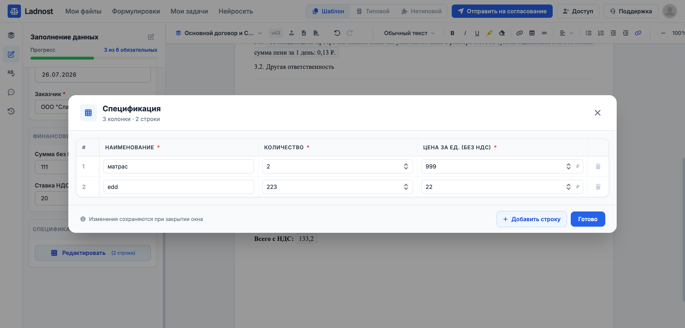
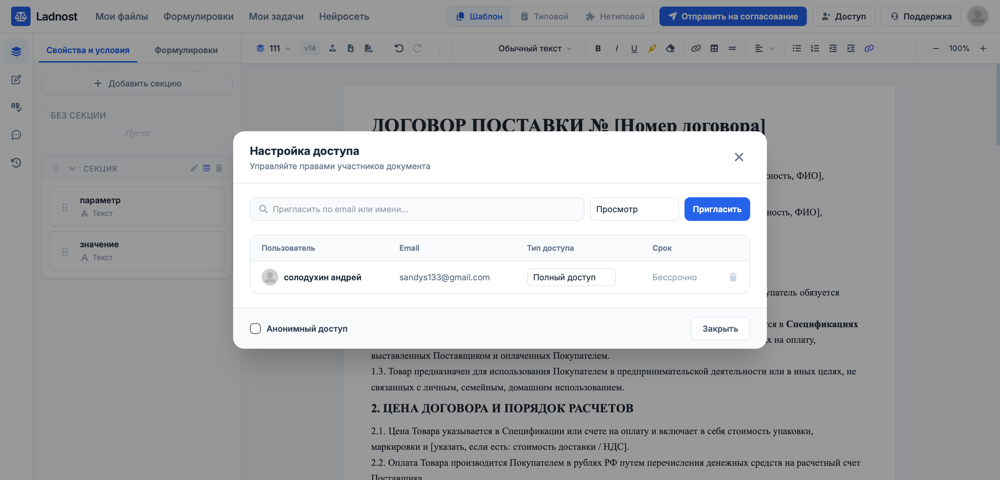
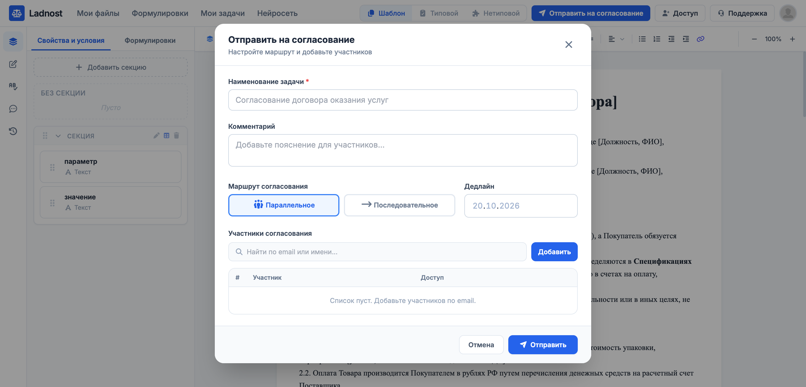
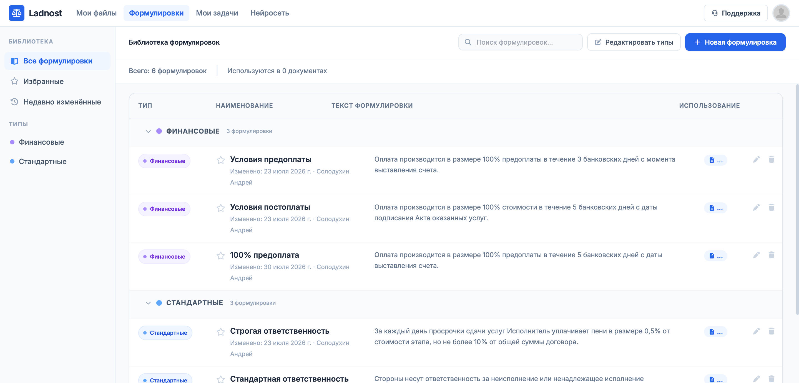
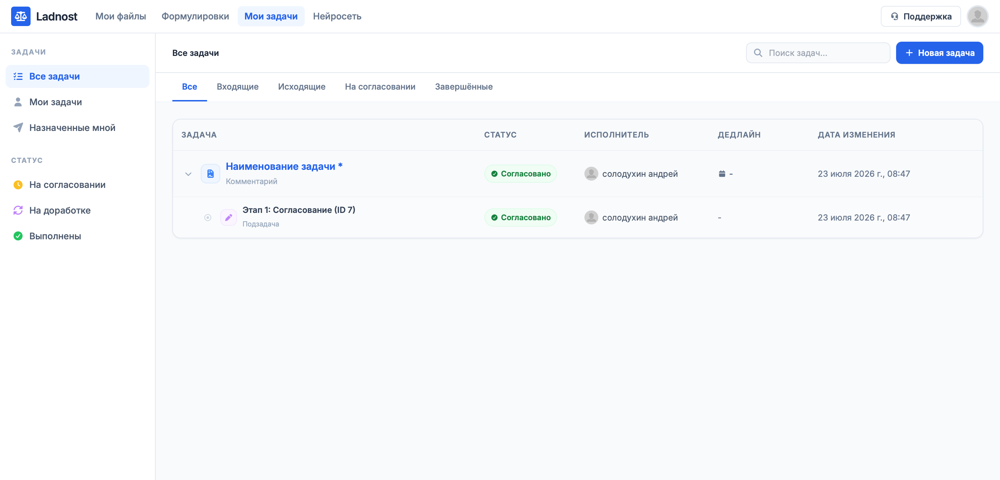
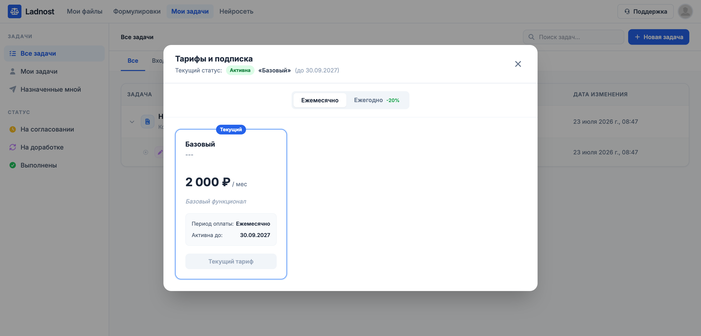
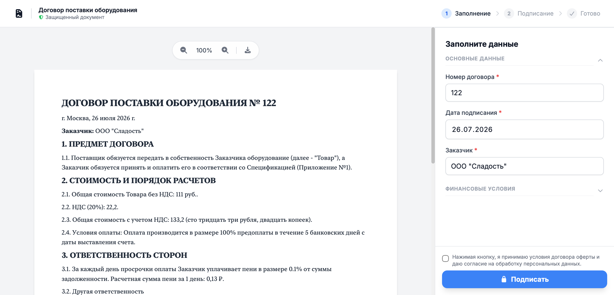

# Ladnost: Contract Lifecycle Management Platform

**Ladnost Contract Lifecycle Management (CLM)** is a scalable, AI-ready platform for automating the creation, approval, signing, and storage of contracts. The system combines the flexibility of a no-code builder, the capabilities of a full-featured text editor, and an architecture ready for deep integration with AI.

<p align="center">
  
  
  
  
  
  
  
  
  
</p>


## 1. Intelligent Contract Builder (Smart Templates)
A powerful document generation engine supporting any level of business logic complexity.
* **3 document working modes:** 
  * *Template* (configuring structure and form).
  * *Standard* (filled strictly via the form, text is protected).
  * *Non-standard* (free text editing while preserving the structure).
* **Smart Form (Form Builder):**
  * Configuration via properties (data), conditions (AND/OR logic), and phrasing (a library of lawyer-approved clauses).
  * Grouping properties into accordion sections for user convenience.
  * Conditional visibility of form fields and document phrasing based on entered data.
* **Automation and Calculations:**
  * Custom formatting of values (numbers, dates, currencies, written-out numbers).
  * Computed fields via custom formulas.
  * Support for an unlimited number of tables within the form/document with automatic formula recalculation.
* **Structure and Navigation:**
  * End-to-end hierarchical numbering of items with automatic recalculation when blocks are hidden or deleted.
  * Internal cross-references to document items.
* **Bundle Support:** Generation of a package of related documents (e.g., Contract + Appendix + NDA) based on a single form.
* **AI-First Approach (YAML):**
  * Form filling and automatic template configuration via YAML.
  * Full LLM compatibility: AI can generate the template structure and fill in data without human intervention.

## 2. Advanced Document Editor
A modern interface for working with text, providing a familiar user experience (UX).
* **Engine:** Built on **Tiptap** (headless WYSIWYG).
* **History and Versioning:** Full version history with rollback capabilities and clear difference highlighting (diff-view).
* **Input Convenience:** Basic functions (undo/redo), automatic recognition and conversion of Markdown when pasting from the clipboard.

## 3. Universal Format Support
Seamless integration with familiar office formats.
* **Storage:** Dual format — structured `tiptap-JSON` (for engine and AI operations) + original file (for archiving and exact layout preservation).
* **Import:** Recognition and conversion from DOCX, PDF, and RTF using `markitdown`.
* **Export:** Generation of ready-to-sign files in DOCX and PDF formats.

## 4. Enterprise Collaboration
Tools for real-time team collaboration on documents.
* **Flexible Access Rights (RBAC):** Role-based model, user invitation via links, and support for anonymous access for external counterparties.
* **Track Changes Mode:** Making edits with visual highlighting of changes (similar to MS Word).
* **Communication:** Threaded comments on specific document sections with the ability to discuss and mention users (@mentions).

## 5. Routing and Approval (Workflow)
Automation of business processes to accelerate deal closure and signing.
* **Flexible Routes:** Support for parallel and sequential approval workflows.
* **Task Automation:** Automatic generation and assignment of tasks to participants upon stage changes.
* **Task Communication:** Discussing nuances directly within the task card, avoiding chat overload.
* **Notifications:** Multi-channel notification system (email, in-app, webhook).

## 6. Platform Architecture and Extensibility
The system is designed as an ecosystem that can be adapted to any enterprise needs.
* **Modular Plugin System:**
  * *Full-stack plugins:* Frontend and backend code is stored in a single plugin folder.
  * *Custom routes and UI:* Plugins can register their own API endpoints and inject components into the interface via a slot system.
  * *Event-driven architecture:* A common Event Bus for synchronizing actions between frontend and backend.
* **Monetization and SaaS:**
  * Built-in tariff and subscription system (multi-tenancy).
  * Architecture ready for connecting any payment gateways via plugins.

## 7. Readiness for Globalization and AI Integrations
Architectural solutions that simplify scaling and AI implementation.
* **Centralized Localization:** All interface strings (frontend) and system messages (backend) are extracted into unified JSON files. This allows AI to be used for accurate, automated, and bulk translation of the platform into any language.

---

### 💡 Key Business Advantages (Value Proposition)
1. **Reduced Time-to-Contract:** Automatic document generation from the form and smart approval routes eliminate legal routine.
2. **AI-Ready out of the box:** YAML integration and structured data storage allow for the seamless implementation of an AI assistant for risk checking, auto-filling, and contract analysis.
3. **Security and Control:** Versioning, edit history, and flexible access rights comply with strict corporate standards (Enterprise-grade).
4. **Low TCO (Total Cost of Ownership):** A powerful plugin system allows businesses to customize the system for their unique processes without modifying the platform's core.


# 🚀 Initial Setup and Launch Guide for Ladnost

This guide provides step-by-step instructions for configuring, building, and running the CLM project using Docker and Docker Compose.

## 📋 1. Prerequisites
- **Docker** and **Docker Compose** installed on your host machine.
- **Git** (for cloning the repository).
- *(Optional)* **Certbot / Let's Encrypt** certificates if you plan to deploy the application in production with HTTPS.

## 📁 2. Directory Structure Preparation
Before starting the containers, ensure the following directories exist in the root of your project:
```text
.
├── messages/         # i18n translation files (JSON)
├── content/          # Static content
├── plugins/          # Backend & Frontend plugins
├── nginx/            # Must contain `default.conf.template`
├── fastapi/          # Backend source code
└── docker-compose.yml
```

## ⚙️ 3. Environment Variables Configuration
You need to create and configure environment files to pass secrets and settings to the containers.


### A. Root Environment File (`./.env`)
Create a `.env` file in the project root. Docker Compose uses this to configure the services and volumes.
```env
# Database Credentials
DB_USER=clm_user
DB_PASSWORD=change_me_secure_password
DB_NAME=clm_db

# Domain Configuration
DOMAIN=localhost
# DOMAIN=yourdomain.com # Use your real domain for production

# pgAdmin Credentials
PGADMIN_EMAIL=admin@example.com
PGADMIN_PASSWORD=change_me_admin_password
```

### B. Backend Environment (`./fastapi/.env.docker`)
Create `.env.docker` inside the `./fastapi` directory. FastAPI will read these variables at runtime.
```env
# Database Connection
DB_DIALECT=postgresql+psycopg2
DB_USER=clm_user
DB_PASSWORD=change_me_secure_password
DB_HOST=postgres
DB_PORT=5432
DB_NAME=clm_db

# Security & JWT
SECRET_KEY=generate_a_strong_secret_key_here
ALGORITHM=HS256
ACCESS_TOKEN_EXPIRE_MINUTES=43200

# Payment Gateway (YooKassa)
YOOKASSA_SHOP_ID=your_shop_id
YOOKASSA_SECRET_KEY=your_secret_key

# AI Integration
OPENAI_API_KEY=your_openai_api_key
OPENAI_BASE_URL=https://api.openai.com/v1

# SMTP Settings
SMTP_HOST=smtp.example.com
SMTP_PORT=587
SMTP_USER=noreply@example.com
SMTP_PASSWORD=your_smtp_password
FROM_EMAIL=noreply@example.com

# App Settings
ADMIN_EMAIL=admin@example.com
FRONTEND_BASE_URL=http://localhost
LOCALE=ru
```

### C. Frontend Environment (`./.env.docker`)
Create `.env.docker` in the project root. Next.js will read these variables during the build process.
```env
PYTHON_BIN=/usr/local/bin/python3
OPENAI_API_KEY=your_openai_api_key
OPENAI_BASE_URL=https://api.openai.com/v1

DOMAIN=localhost
# DOMAIN=yourdomain.com # Must match the domain in the FRONTEND_BASE_URL

NEXT_PUBLIC_DOMAIN=localhost
NEXT_LOCALE=ru
NEXT_FORMAT_LOCALE=ru-RU
```

## 🛡️ 4. Nginx and SSL Configuration
- Ensure you have a valid Nginx configuration template at `./nginx/default.conf.template`.
- **Local Development:** Configure Nginx to serve HTTP on port 80 without SSL.
- **Production:** The `docker-compose.yml` expects Let's Encrypt certificates on the host at `/etc/letsencrypt`. Ensure you have generated certificates for your `DOMAIN` and that the host path matches the volume mount: `/etc/letsencrypt:/etc/letsencrypt:ro`.

## 🐳 5. Building and Starting the Project
Run the following command in the project root to build the images and start all containers in detached mode:

```bash
docker-compose up --build -d
```
*Note: The initial build may take several minutes as it installs dependencies for both FastAPI and Next.js, and generates plugin registries.*

## 🌐 6. Accessing the Services
- **Frontend (Next.js via Nginx):** `http://localhost` (or `https://<your_domain>` if SSL is configured).
- **pgAdmin (Database GUI):** `http://localhost:5050`
  - *Email:* The email specified in `PGADMIN_EMAIL`
  - *Password:* The password specified in `PGADMIN_PASSWORD`
- **FastAPI Backend:** Exposed internally via Nginx at `/api/v1`. You can access the Swagger UI directly for debugging (if enabled in FastAPI) by checking the container logs or mapping a port temporarily in `docker-compose.yml`.

## 🧩 7. Working with the Plugin System
The project utilizes a dynamic plugin architecture for both the backend and frontend.
- **Backend Plugins:** The FastAPI loader automatically scans the `./plugins` directory on startup. Each plugin must have a `plugin.json` manifest and a Python backend module.
- **Frontend Plugins:** During the Next.js build, a script scans the `./plugins` directory and generates dynamic App Router routes (`app/(plugins)`) and component registries (`lib/generatedPlugins.ts`).
- **Disabling Plugins:** To disable a plugin without deleting it, open its `plugin.json` and set `"enabled": false`.

## 🌍 8. Internationalization (i18n)
- **Frontend:** Uses `next-intl`. Add your translation JSON files to the `./messages/` directory (e.g., `ru.json`, `en.json`).
- **Backend:** Uses a custom `I18n` class that also reads from the `./messages/` directory. Ensure the `LOCALE` environment variable matches your default language file.
